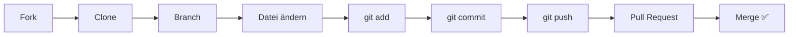

<div align="center">

# 🌱 Git verstehen & anwenden

**Handout und Hands-on zum Vortrag „Git – The information manager from hell"**

[](LICENSE)
[](#-hands-on-dein-erster-commit)
[](CONTRIBUTING.md)
[](https://github.com/OWNER/git-handout/actions/workflows/validate-kudos.yml)

*Ernesto Behrendt · OSZ Technik Teltow · 09.10.2026*

[Handout](handout/GIT-HANDOUT.md) · [Hands-on](#-hands-on-dein-erster-commit) · [Troubleshooting](#-troubleshooting) · [Quellen](#-quellen)

</div>

---

## 📖 Inhalt

- [Worum geht es?](#-worum-geht-es)
- [Voraussetzungen](#-voraussetzungen)
- [Hands-on: Dein erster Commit](#-hands-on-dein-erster-commit)
  - [Variante A: Mit GitHub-Account (Pull Request)](#variante-a-mit-github-account-fork--pull-request)
  - [Variante B: Ohne Account (nur lokal)](#variante-b-ohne-account-nur-lokal)
- [Der Workflow im Überblick](#-der-workflow-im-überblick)
- [Troubleshooting](#-troubleshooting)
- [Repository-Struktur](#-repository-struktur)
- [Quellen](#-quellen)
- [Lizenz](#-lizenz)

## 🎯 Worum geht es?

Dieses Repository begleitet den Vortrag und ist gleichzeitig dein **Übungsplatz**:

| Was | Wo |
| --- | --- |
| 📄 Handout mit Architektur und wichtigsten Befehlen | [`handout/GIT-HANDOUT.md`](handout/GIT-HANDOUT.md) |
| 💬 Deine Aufgabe: ein Kompliment zum Vortrag committen | [`kudos/`](kudos/) |

Nach ca. 10 Minuten hast du:

1. ein Repository **geklont** (`git clone`),
2. einen **Branch** angelegt (`git switch -c`),
3. eine Datei **hinzugefügt und committet** (`git add`, `git commit`),
4. deine Änderung **veröffentlicht** (`git push`) und einen **Pull Request** geöffnet.

## ✅ Voraussetzungen

| Voraussetzung | Prüfen mit | Download |
| --- | --- | --- |
| Git ≥ 2.23 | `git --version` | [git-scm.com/downloads](https://git-scm.com/downloads) |
| Texteditor (z. B. VS Code, Notepad++) | – | [code.visualstudio.com](https://code.visualstudio.com) |
| GitHub-Account (nur Variante A) | – | [github.com/signup](https://github.com/signup) |

Einmalige Einrichtung (falls noch nicht geschehen):

```bash
git config --global user.name  "Dein Name"
git config --global user.email "deine@mail.de"
```

> 💡 **Tipp:** Wenn du deine Mailadresse nicht öffentlich zeigen willst, nutze die
> `…@users.noreply.github.com`-Adresse aus den GitHub-Einstellungen unter *Settings → Emails*.

## 🚀 Hands-on: Dein erster Commit

### Variante A: Mit GitHub-Account (Fork + Pull Request)

**1. Fork erstellen**
Klicke oben rechts auf **Fork** und bestätige. Du bekommst eine eigene Kopie unter `github.com/<DEIN-USERNAME>/git-handout`.

**2. Fork klonen**

```bash
git clone https://github.com/<DEIN-USERNAME>/git-handout.git
cd git-handout
```

**3. Eigenen Branch anlegen**

```bash
git switch -c kudos/<DEIN-USERNAME>
```

**4. Kompliment-Datei erstellen**
Kopiere die Vorlage und benenne sie nach deinem GitHub-Namen:

```bash
# Linux / macOS / Git Bash
cp kudos/_TEMPLATE.md kudos/<DEIN-USERNAME>.md

# Windows PowerShell
Copy-Item kudos/_TEMPLATE.md kudos/<DEIN-USERNAME>.md
```

Öffne die Datei im Editor, ersetze die Platzhalter und schreibe dein Kompliment.

> ⚠️ **Wichtig:** Genau **eine** Datei, genau **dein** Name. So gibt es keine Merge-Konflikte.

**5. Änderung prüfen, vormerken und committen**

```bash
git status                       # Was hat sich geändert?
git add kudos/<DEIN-USERNAME>.md # In die Staging Area
git commit -m "kudos: Kompliment von <DEIN-USERNAME>"
```

**6. Veröffentlichen**

```bash
git push -u origin kudos/<DEIN-USERNAME>
```

**7. Pull Request öffnen**
Auf GitHub erscheint ein Banner **„Compare & pull request"**. Klicke darauf, prüfe die Vorlage und sende den PR ab. 🎉

Sobald der Vortragende deinen PR **mergt**, ist dein Kompliment Teil der Projekt-Historie:

```bash
git switch main
git pull upstream main   # siehe Hinweis unten
git log --oneline --graph
```

<details>
<summary>ℹ️ Upstream einrichten (optional)</summary>

```bash
git remote add upstream https://github.com/OWNER/git-handout.git
git fetch upstream
```

</details>

### Variante B: Ohne Account (nur lokal)

Du kannst alles auch rein lokal ausprobieren, ganz ohne GitHub-Konto:

```bash
git clone https://github.com/OWNER/git-handout.git
cd git-handout
git switch -c kudos/mein-name
cp kudos/_TEMPLATE.md kudos/mein-name.md
# Datei bearbeiten …
git add kudos/mein-name.md
git commit -m "kudos: Kompliment von mein-name"
git log --oneline
```

Du hast damit alle lokalen Git-Basics angewendet. Nur `push` und Pull Request entfallen.

## 🧭 Der Workflow im Überblick



```text
Working Directory ──git add──► Staging Area ──git commit──► Local Repo ──git push──► Remote (GitHub)
```

## 🛠 Troubleshooting

| Problem | Lösung |
| --- | --- |
| `git: command not found` | Git installieren und Terminal neu starten |
| `Author identity unknown` | `git config --global user.name` und `user.email` setzen (siehe oben) |
| Push wird abgelehnt / Passwort-Abfrage | GitHub akzeptiert keine Passwörter. Nutze den Browser-Login des *Git Credential Manager* oder ein [Personal Access Token](https://github.com/settings/tokens) |
| `error: pathspec … did not match` | Prüfe mit `git status`, ob du im richtigen Ordner bist und die Datei existiert |
| Falschen Branch erwischt | `git branch` zeigt den aktuellen Branch, wechsle mit `git switch <name>` |
| Commit-Message vertippt | `git commit --amend -m "neue Nachricht"` (nur vor dem Push!) |
| Alles hakt | Hand heben, wir schauen gemeinsam drauf 🙋 |

## 🗂 Repository-Struktur

```text
git-handout/
├── .github/
│   ├── workflows/validate-kudos.yml   # CI-Check für Pull Requests
│   └── PULL_REQUEST_TEMPLATE.md
├── handout/
│   └── GIT-HANDOUT.md                 # Cheat Sheet zum Vortrag
├── kudos/
│   ├── _TEMPLATE.md                   # Vorlage für dein Kompliment
│   └── README.md
├── CONTRIBUTING.md
├── LICENSE
└── README.md
```

> 🤖 Der Workflow in `.github/workflows/` ist ein kleines Praxisbeispiel für **CI/CD**: Jeder Pull Request wird automatisch geprüft, bevor er gemergt wird.

## 📚 Quellen

- [git-scm.com/docs](https://git-scm.com/docs): Offizielle Dokumentation
- GitHub Blog: „Git turns 20", April 2025
- [tutorialpedia.org](https://www.tutorialpedia.org)
- [thoughtbot: Git Object Model](https://thoughtbot.com/upcase/videos/git-object-model)

## 📄 Lizenz

Veröffentlicht unter der [MIT-Lizenz](LICENSE).

<div align="center">

**Viel Spaß beim Committen! 🚀**

</div>
